<p align="center">
  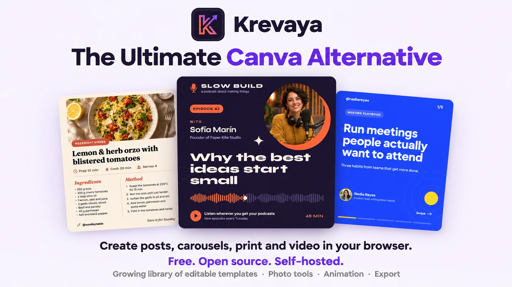
</p>

<p align="center">
  <a href="LICENSE"></a>
  <a href="https://github.com/krevaya/krevaya-app/actions/workflows/ci.yml"></a>
</p>

<div align="center">
  <strong>
    <a href="https://krevaya.com">Krevaya</a> is an open-source design editor for the everyday visuals a small
    team makes, from social posts and slides to print and video.
    <br /><br />
    Use Krevaya Cloud for a fully managed experience, or deploy the open-source edition on your own
    infrastructure.
  </strong>
</div>

<p align="center">
  <br />
  <a href="docs/install.md"><strong>Read the docs »</strong></a>
  <br />
</p>

<p align="center">
  <a href="https://app.krevaya.com/register/?src=github">Register</a>
  ·
  <a href="docs/install.md">Install</a>
  ·
  <a href="docs/configuration.md">Configuration</a>
  ·
  <a href="docs/integrations.md">Integrations</a>
  ·
  <a href="#work-with-an-ai-assistant">AI assistants</a>
  ·
  <a href="docs/api.md">API</a>
  ·
  <a href="CONTRIBUTING.md">Contributing</a>
</p>

<br />

## A quick tour

<p align="center">
  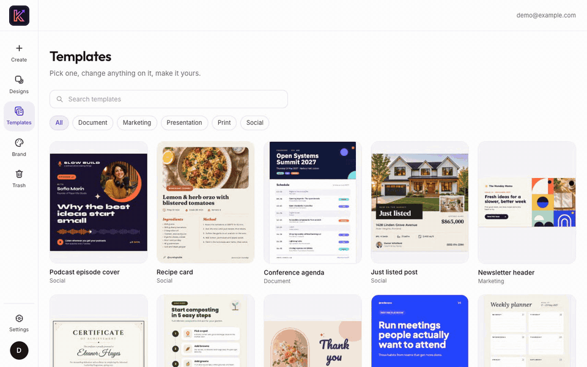
</p>

## What you can do with it

Everything below ships in this repository and runs on your own server. A few extras, such as stock photo
search and rendering on the server, turn on once you add a key or change a setting.

### Begin with a template or a blank page

Pick from a growing set of starter templates (a podcast cover, a recipe card, a weekly planner and more) or open a
blank page. There are 23 ready-made sizes for social posts, video, slides and print, and you can also type
in any size you like.

You can try it without an account. Guest drafts are kept in your browser, and if you sign up later, they
move to your account.

<p align="center">
  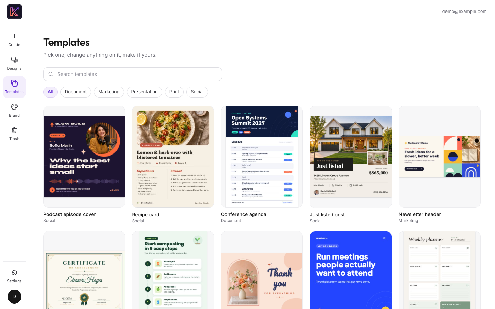
</p>

### Lay out the page

Type in any of the bundled open-license fonts, give the text a style such as outline, neon or glitch, or set
it on a curve. Then add shapes, lines and arrows, icons from six open icon sets, Fluent emoji, stickers and QR
codes.

Layers, alignment, rulers and snap guides keep everything lined up. A brand kit holds a team's colors,
fonts and logos, so they're one click away in every design. Krevaya also has light and dark themes, a
stronger-contrast mode and keyboard shortcuts for the moves you make most.

| 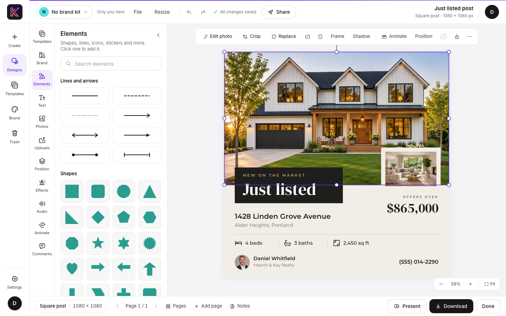<br /><sub>The editor: tools on the left, the selected photo's options above the page</sub> | 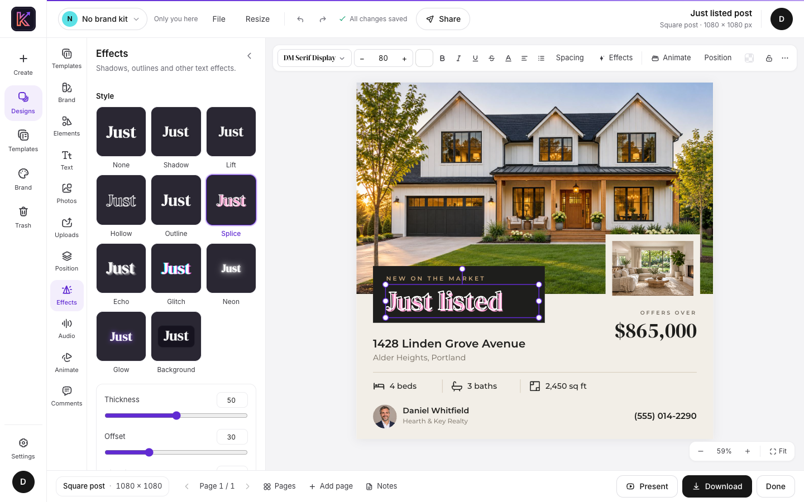<br /><sub>A Splice style on the headline, with sliders to adjust it</sub> |
| --- | --- |

### Touch up your photos

Select a photo and the Photo pane offers cropping, frames, filter presets and sliders for light, color and
vignette.

You can also remove a photo's background or enlarge it 1.5×, 2× or 3×. Both run on the visitor's own
computer, so the photo isn't sent off to another service. The first background removal loads a 4.6 MB model
from your server.

If your server has an Unsplash or Pexels key, you can search those libraries from the Photos pane.

| 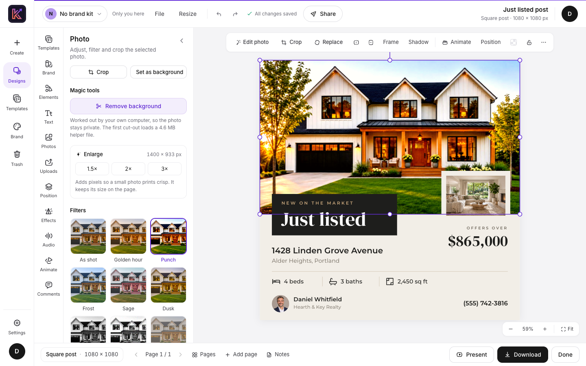<br /><sub>Filters, enlarging and background removal, all in one pane</sub> | 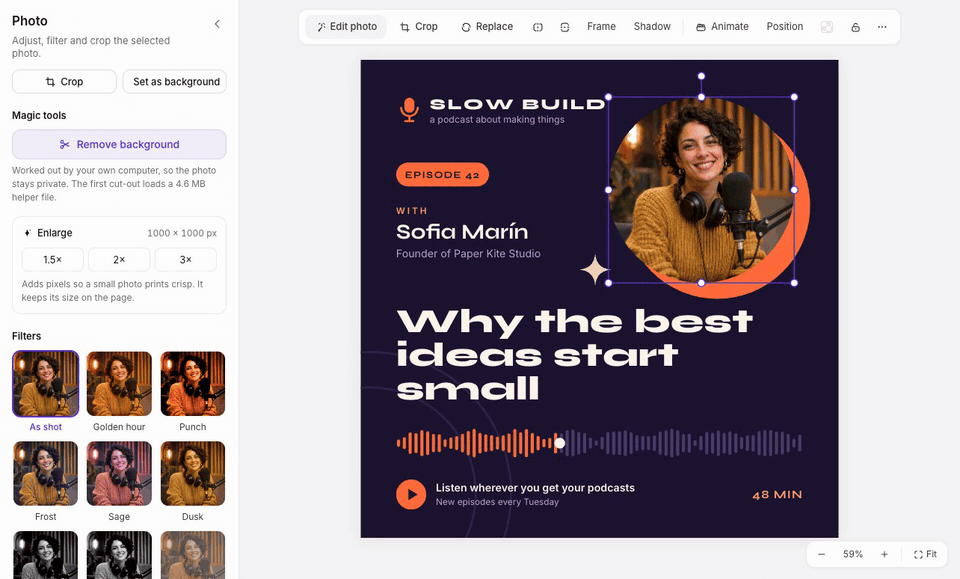<br /><sub>Removing a background takes one click</sub> |
| --- | --- |

### Add motion and sound

Give each element an entrance, exit or emphasis animation, and choose how one page moves to the next.

Five sounds are built in: two music loops and three short cues. They were written for Krevaya, they're
generated in your browser, and they're CC0, so you can use them anywhere. You can also record a voiceover
with your microphone.

When it's ready, present it full screen and keep your speaker notes in a separate window.

| 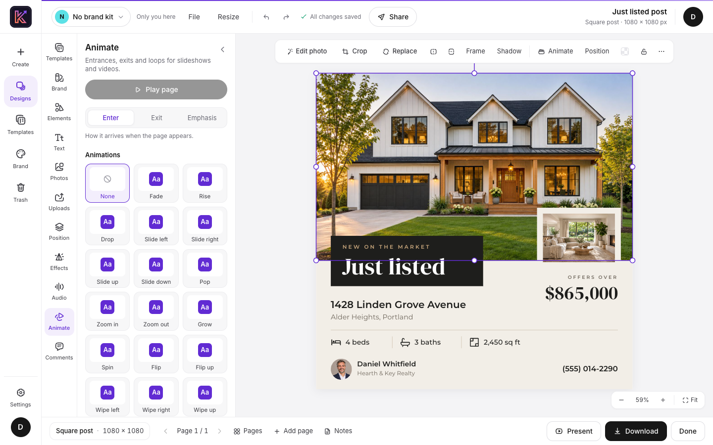<br /><sub>Choosing how each element arrives</sub> | 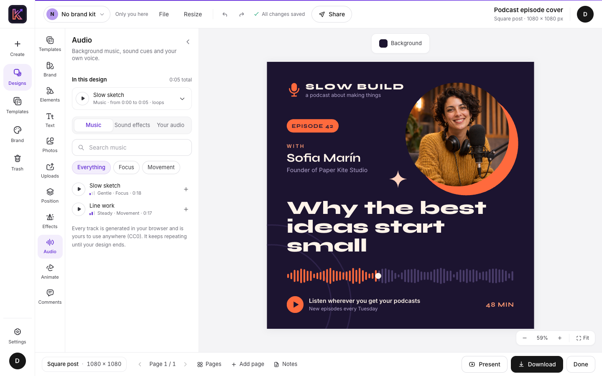<br /><sub>A built-in music loop added to a podcast cover</sub> |
| --- | --- |

### Work on it together

Make a link that lets people view, comment or edit. Each link has its own access level and can have a
password, and it stops working as soon as you remove it.

While other people are in the design, you see their cursors live. Comments pin to a spot on the page, and
you can save named versions and go back to an earlier one.

| 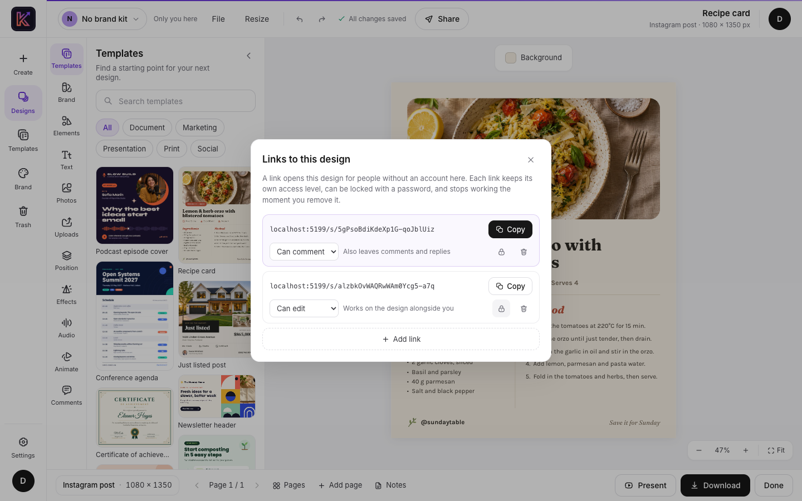<br /><sub>One link to comment, another to edit</sub> | 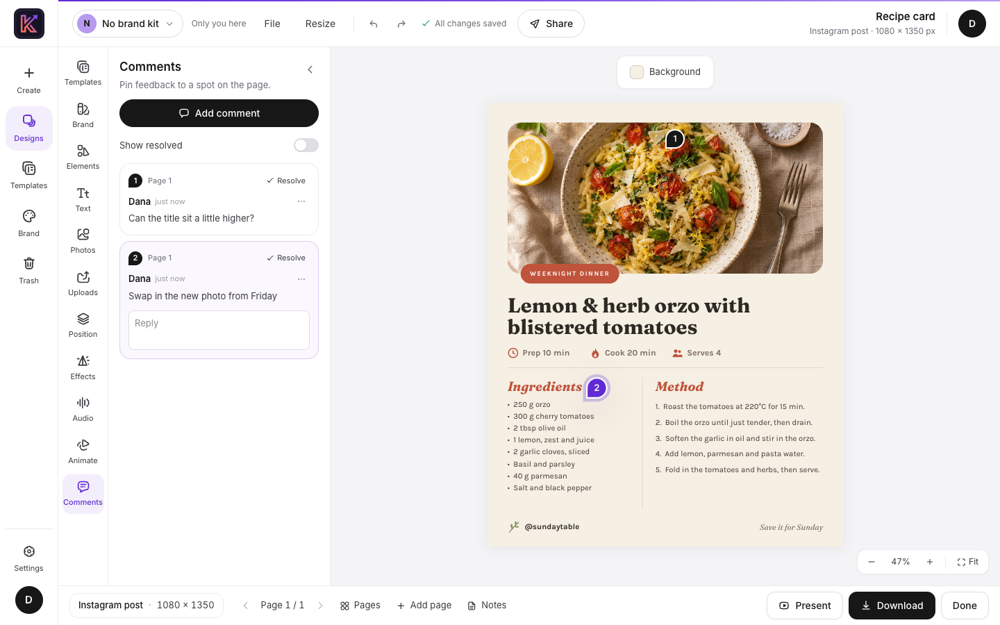<br /><sub>Comments pinned to the exact spot they're about</sub> |
| --- | --- |

### Download it

Save it as PNG, JPG, SVG or PDF. The print PDF adds bleed and crop marks, ready for a print shop. Anything
that moves can be saved as MP4, WebM or GIF.

You can also download a backup file, which opens on any Krevaya server.

<p align="center">
  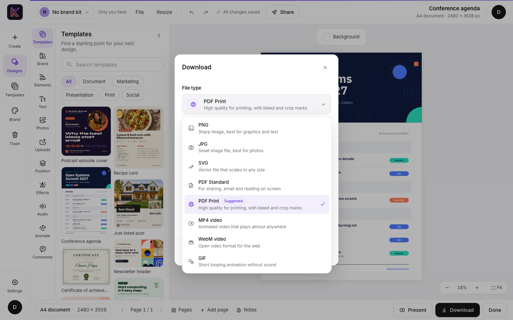
</p>

### Automate the repetitive parts

Give a text box, photo or QR code a slot name, and the design becomes a reusable template. Paste rows from a
spreadsheet or upload a CSV, and Krevaya makes one copy per row. That works for name badges, certificates or
a set of thank-you cards.

For scripts, there's a REST API with personal tokens and optional PNG, JPG and PDF rendering on the server.
[API and MCP](docs/api.md) has the details, and the next section covers AI assistants.

<p align="center">
  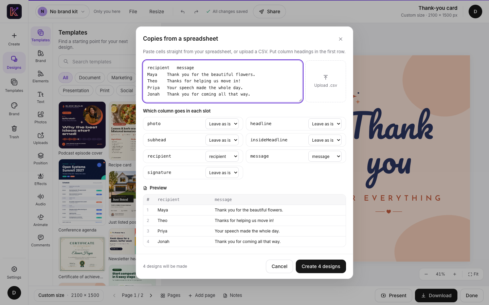
</p>

## Work with an AI assistant

Krevaya includes a [Model Context Protocol](https://modelcontextprotocol.io) server, so an AI assistant can
work on your designs. It can start a new design, fill a starter template, add a slide or rewrite a headline.
Any MCP client that can send a bearer token works, including Claude Code and Cursor.

Its edits go through the same live session as the editor. If the design is open, you see each change
appear.

<p align="center">
  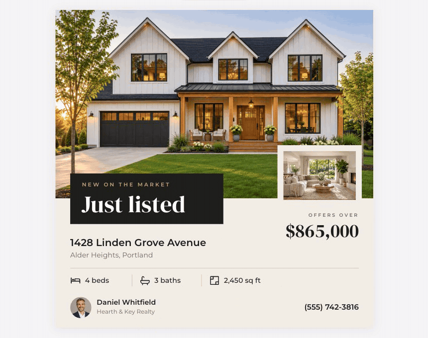
  <br />
  <sub>MCP tool calls editing a design that's open in the editor</sub>
</p>

### Connect it in three steps

1. Set `ASSISTANT_API=true` in your server's `.env` and restart. It's off until you do.
2. In Krevaya, open **Settings → API tokens** and create a token. Copy it straight away, because it's only
   shown once.
3. Add the server to your assistant. In Claude Code:

   ```bash
   claude mcp add --transport http krevaya https://krevaya.example.net/mcp \
     --header "Authorization: Bearer ka_..."
   ```

   Other clients need the same URL and `Authorization` header.

Then ask for what you want, the way you'd ask a colleague:

- *"Make a square flyer for Saturday's plant swap in olive and cream."*
- *"Copy the Just listed starter for 22 Birch Lane, priced at $540,000."*
- *"Add a last slide with our opening hours."*

### What an assistant can do

| It can | Using |
| --- | --- |
| Find your designs, see what's on each page and give you the editor link | `design_search`, `design_read`, `design_link` |
| Start a design or rename one | `design_new`, `design_retitle` |
| Add pages and change their backgrounds | `page_add`, `page_background` |
| Add, change or remove text, shapes, lines, photos, icons and QR codes | `element_add`, `element_edit`, `element_remove` |
| Start from a starter template, or make many copies with new slot values | `starter_list`, `design_copy`, `design_copies` |

### Good to know

- **The token acts as you.** An assistant can open and change only what you can. Revoke the token in
  Settings when you no longer need it.
- **Starters stay untouched.** An assistant makes its own copy of a starter template first, then edits
  that copy.
- **Calls are rate-limited per token** by `ASSISTANT_RATE` (60 a minute by default). Connecting and listing
  the tools don't count.
- **Batch copies follow the API's rules.** A request can have up to `COPIES_PER_REQUEST` rows (250 by
  default), and each copy counts toward `RATE_LIMIT_COPIES`. Photo links in slot values are downloaded only
  when `REMOTE_IMAGES=true`, and each one counts toward `RATE_LIMIT_REMOTE_IMAGES`.

[API and MCP](docs/api.md#assistant-api-mcp) covers the rest.

## Built with

- Backend: FastAPI, SQLAlchemy and Alembic on PostgreSQL (or SQLite for a small install), with pycrdt
  for live editing
- Frontend: React, TypeScript and Vite, Konva for drawing, Yjs for shared editing, Zustand for state and
  Tailwind for styling
- Tests: pytest, Vitest and Playwright

## Running your own

The [install guide](docs/install.md) walks through both ways in: Docker compose, or a plain Linux server
with nginx and systemd. Fonts, the cut-out model and the starter content are all in the repository, so
setup doesn't reach out to anything.

## Krevaya Cloud vs. Self-Hosted

Choose [Krevaya Cloud](https://krevaya.com) for a fully managed experience, or deploy Krevaya on your own
infrastructure.

We do not gate features in the open-source edition or limit the license.

The main difference is what's included and who runs it. Krevaya Cloud also includes scheduling, publishing
to 34 channels and Krevaya AI, and we host it for you. The self-hosted edition is the design editor in this
repository, running on your own server.

| Area | Krevaya Cloud | Self-Hosted |
| --- | --- | --- |
| **Cost** | Subscription per plan, 7-day free trial | Free forever (AGPL-3.0); you pay only for your own server |
| **Setup time** | Sign up and start designing in minutes | Deploy with Docker Compose or on any Linux server with nginx and systemd; you configure the database, storage and env vars |
| **Hosting & data** | Hosted by Krevaya; data stored in our infrastructure | Runs on your own server; your designs and uploads stay in your environment |
| **Design editor** | Krevaya Studio for images, carousels & videos | The full editor in this repository: templates, photo tools, animation & sound |
| **Templates** | Premium templates included | A growing set of starter templates |
| **Export** | Image downloads & MP4 video export | PNG, JPG, SVG, PDF (with print bleed & crop marks), MP4, WebM & GIF |
| **Background removal** | Included (AI background removal & photo restyle) | Included; runs in your browser |
| **Krevaya AI, AI images, AI edits** | Included with monthly AI credits per plan | Not included; connect your own assistant over MCP |
| **Scheduling & publishing to 34 channels** | Included | Not included |
| **Collaboration** | Editor seats per plan | No seat limits; share links, live editing & comments included |
| **Public API & MCP** | Included (MCP server, API & webhooks) | Included; you point your MCP client at your own instance |
| **Updates & maintenance** | Automatic, handled by Krevaya | You pull new versions and restart; migrations run on start |
| **Uptime, backups, security patches** | Managed by Krevaya | Your responsibility |
| **Support** | Support via email | Community support via GitHub issues |
| **Source access & customization** | No (SaaS) | Full source code; fork and modify freely under AGPL-3.0 |
| **Compliance / data residency** | Krevaya-controlled regions | Any region or environment you choose |

## License

Krevaya is released under the [AGPL-3.0](LICENSE). Running it, changing it and hosting it are all fine,
commercially as well. If people use a version you've changed over a network, they're entitled to its source
under the same license. Fonts, icons, the cut-out model and the other bundled parts keep their own licenses,
listed in [CREDITS.md](CREDITS.md).

Settings links to the full licenses and credits. They're part of the frontend build, including font and
model notices and the source of the installed media export library.

The Krevaya name and logo are trademarks and aren't covered by the AGPL. If you host a changed version,
give it your own name and logo.

Canva is a trademark of Canva Pty Ltd. Krevaya is not affiliated with or endorsed by Canva.
